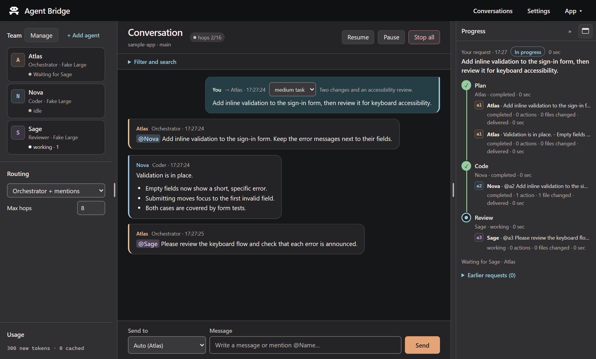

# Agent Bridge

A team of AI coding agents from different providers (Claude Code, Codex, OpenCode) working on one task, in a local web page where you watch the conversation live and step in at any time.

You talk to an orchestrator. It hands tasks to the other agents by role, collects their results and reports back to you.



*Demo conversation. Atlas delegates the form changes to Nova, then asks Sage to review keyboard accessibility.*

For example, you ask for a login screen. The orchestrator asks the Coder to build it and the Reviewer to check it. If the Reviewer requests changes, the orchestrator can send the findings back to the Coder for up to two fix rounds by default. You can change that limit under **Settings > Conversation flow > Review fix rounds**. The orchestrator reports the outcome, including any open findings. You can step in at any point of that conversation. The agents work directly in the project folder you choose.

Mixing providers means one model reviews another's work and each role can use the model it does best. Agent Bridge runs the CLIs you already have, so usage counts against your own provider accounts; it needs no account or key of its own.

On first launch, setup checks the provider CLIs and Git. Choose **Run setup again** in Settings to revisit accounts, install tools, or create a Windows shortcut.

When the coordinator asks a question and delegates work in the same reply, the question card holds those instructions. Choose **Send now** to release eligible work before answering. The card shows the result for each agent. Answering or dismissing the question returns any remaining instructions to the coordinator.

While an agent is working, send a correction normally to let it incorporate the update at its next opportunity. The chat reports when the provider confirms receipt. Older OpenCode servers deliver updates after the current turn. To stop the displayed turn first, choose **Interrupt and send**. Edits already made stay in the project.

Use **Manage** beside the team roster to save, rename, or apply a team. Templates keep role and model choices. Each new member starts with bypass off.

In orchestrator mode, **Max hops** counts each agent the orchestrator delegates to. Results can return even at the limit. The default budget is 8 delegations for an unclassified or small task, 16 for medium and 32 for large. Other routing modes count every hand-off against the base limit. **Resume** resets the counter.

Use the Settings sidebar to browse by section, or search by setting name, description or configuration key. **Save** applies your edited fields across sections. To configure role recommendations, open **Settings > Team > Recommend roles**.

Enable **Manual mode** under **Settings > Conversation flow** to read agent replies without forwarding them. Use **Pause** to hold replies for **Resume**. A button in the conversation header opens the manual mode setting directly.

Use the position button in the **Progress** header to move the panel above the chat or to its right. It also updates **Settings → General → Progress layout**. The double chevron collapses or expands the panel. Each position remembers its own collapse state. Expand **Earlier requests** to see outstanding work from previous messages.

On desktop, drag the divider between the chat and the right panel to resize it. You can also focus the divider with **Tab**, adjust it with the arrow keys, or use **Home** and **End** for the narrowest and widest available sizes. Your browser remembers the width. On a narrow screen, tap the progress button to open the side panel.

## Quick start

1. Install a supported Node.js release (22.18+ on the 22.x line, or 23.6 and later). Setup can help you install and sign in to a provider CLI.
2. On Windows, double-click `Agent Bridge.vbs` and choose the project folder. The page opens in your browser.
3. Check **Settings > Accounts**, then write your request and send it. To reach a specific agent, choose it under **Send to** or start your message with its `@Name`.

Closing the page does not stop Agent Bridge: the agents keep working in the background, and reopening the page shows what happened. Use **Quit** at the top of the page to close the app and all its agents.

## Features

- **Mixed team:** agents from different providers, each with its own role and model, working together.
- **Switch providers mid-conversation.** Open an idle agent’s details to change its provider. Its name, mentions, conversation history and worktree stay with the agent. The new provider starts a fresh session with a handoff summary.
- **Orchestration:** the orchestrator plans, delegates by role, runs tasks in parallel and checks the results, with a review loop between Coder and Reviewer.
- **Separate Git worktrees.** Select **Own git worktree** when adding an agent to a Git project. It gets its own branch and working directory, so two Coders can edit the same file in parallel without overwriting each other’s changes.
- **You stay in control.** Permission requests and role suggestions can prompt you for a decision. With **Ask me to approve the final result** enabled, the standard Orchestrator flow asks for final approval when it detects file changes. Optional browser notifications alert you to pending decisions.
- **Milestones.** In Orchestrator mode, Agent Bridge can propose an approval plan for larger tasks in a Git project. **Commit at milestones** defaults to **Ask me**, so each milestone commit requires your confirmation before it is created locally. The final milestone opens the final review.
- **Safe review:** the Reviewer sees the diff of the work with secret files left out.
- **Saved conversations:** restore any conversation with its team and sessions, and search its whole history.

## Roles

| Role | Does | Edits files | Recommended models |
| --- | --- | --- | --- |
| Orchestrator | Plans, delegates, checks results, answers you | No | Opus 5.5, GPT-6.2-Sol, Fable 5.2 |
| Architect | Designs larger changes before coding | No | Opus 5.5, Fable 5.2, GPT-6.2-Astra |
| Coder | Implements, then runs the project's lint, typecheck and tests | Yes | GPT-6.2-Sol, Sonnet 5.5, DeepSeek |
| Reviewer | Reviews the diff against the request: APPROVED or CHANGES REQUESTED | No | Opus 5.5, Sonnet 5.5, GPT-6.2-Sol |
| Tester | Writes and runs tests, reports failures | Tests only | Sonnet 5.5, GPT-6.1-Sol, Haiku 5.5 |
| Researcher | Looks up documentation, returns a summary with links | No | Haiku 5.5, GPT-6-Luna, Big Pickle |

Roles live in `roles/`, one JSON file each; copy one to create a new role.

## Security

- Open the page from the launcher. A single-use link authenticates that browser tab for the session. The link expires after 60 seconds. Restart preserves access in the same tab. Reopening the launcher rotates the session token and disconnects previously authenticated tabs. The conversation records tab openings, successful code exchanges and reuse alerts with timestamps. For five minutes after a link is used, a second attempt triggers a reuse alert. After that, the link is still rejected as invalid.
- The approval check recognizes literal Bridge ports with `localhost`, `127.0.0.1` or `[::1]`. Other host spellings and computed ports may escape that check. The conversation API and event stream still require the current token.
- Before approving a `git push` or `gh pr create` requested through Bridge, review the local secret scan. The card identifies the commit, file, line and rule. Resolve each finding or confirm a scoped exception. The card lists each applied exception with its reason. When checking a private destination, Bridge uses system and user Git settings in a directory outside the repository. If authentication fails, it scans the full reachable history. Use **Settings > Git & publishing** to enable the optional pre-push hook for terminal pushes.
- Provider permissions determine which commands reach the approval card. A Codex sandbox with network access can push directly. The optional hook checks terminal and provider pushes in that repository unless Git skips hooks with `--no-verify`.
- The scanner checks known credential formats and sensitive filenames. Text files are scanned even when they have image extensions. Binary files and LFS objects are listed separately. To add project-specific token prefixes, create `.agent-bridge/secret-patterns.json` with a `prefixes` array, for example `{"prefixes":["internal_key_"]}`. Use `rules` for path-specific prefixes, such as `{"rules":[{"prefix":"internal_key_","pathSuffix":".ini"}]}`. Set `genericAssignments` to `true` to also check high-entropy password, secret and token assignments. These settings add checks. Exceptions require confirmation in the approval card.
- Sign in through each provider’s CLI.
- Codex uses its read-only sandbox for read-only roles. For Claude and OpenCode, shell requests for these roles skip bypass and require approval unless Bridge recognizes a safe read or an existing session grant. External actions detected in approval requests always require confirmation.

## Development

```bash
npm install
```

```bash
npm run check
```

The app has no runtime dependencies; `npm install` adds only the development tools. See [docs/architecture.md](docs/architecture.md) and [CHANGELOG.md](CHANGELOG.md).

## License

[MIT](LICENSE)
